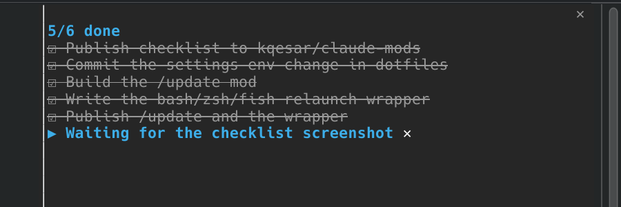

# checklist

When Claude works through a plan, the plan scrolls away. Twenty tool calls
later you are scrolling back up to figure out which step it is on. I wanted
the list pinned next to the chat, ticking itself off as Claude goes. That's
this mod.



What you get:

- **A pane that stays beside the conversation** and updates live: ☐ to do,
  ▶ in progress (in bold, with what Claude is doing right now), ☑ done and
  struck through.
- **A counter under the prompt** for when the pane is closed. It turns into
  `7/7 ✓` at the end.

  

- **A ✕ on every open task** to drop it from Claude's list. It asks before
  deleting, and finished tasks stay put.
- **Claude actually fills it.** The mod tells Claude to turn every approved
  plan into tasks, and reminds it the moment you accept a plan.

`/checklist` opens the pane. In the fullscreen terminal it also opens by
itself as soon as the first task shows up.

## Setup

1. Install the mod from a Claude Code session:

   ```
   /plugin install checklist --marketplace kqesar/claude-mods
   ```

2. **Turn on the task tools.** Some models don't get `TaskCreate` /
   `TaskUpdate` by default, and without them the pane stays empty. Add this
   to `~/.claude/settings.json` (inside your existing `env` block if you have
   one), then restart Claude Code:

   ```json
   { "env": { "CLAUDE_CODE_ENABLE_TODO_TOOLS": "1" } }
   ```

   If you forget, the mod tells you with a toast.

## Good to know

- It is a terminal thing. claude.ai/code and the mobile app don't show
  plugin panes, and the counter doesn't show there either.
- Subagents keep their own lists; only the main conversation's tasks appear.
- Models that use `TodoWrite` instead of the task tools are shown too, just
  without the ✕ (those lists have no task ids to delete by).

## How it works

The plugin API doesn't expose Claude's task list, so the mod keeps a copy in
the session state and updates it from every `TaskCreate`, `TaskUpdate` and
`TodoWrite` call it sees. When Claude calls `TaskList`, the copy is replaced
by the real list, which is how it catches up after a `/resume`. The ✕ calls
`TaskUpdate` with `status: "deleted"` itself, so Claude's own list changes
too, not just the pane.
