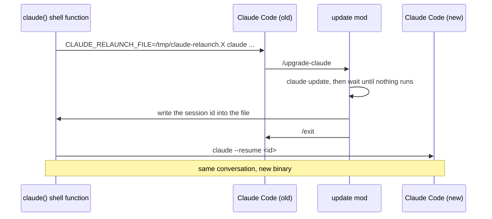

# update

Claude Code updates itself in the background, but the session you have open
keeps running the old version until you quit. And quitting in the middle of
work is exactly what you don't want to do.

So: type `/upgrade-claude` and keep working. It installs the new version, waits for
Claude to be done with whatever it is doing, then restarts on the same
conversation. You lose two or three seconds, not your context.

```
> /upgrade-claude
Claude Code 2.1.311 installed (running 2.1.310). Restarting once nothing
runs: 1 agent running. `/upgrade-claude now` restarts regardless, `/upgrade-claude cancel`
keeps this version.

  ↻ 2.1.311 waits: 1 agent running
```

"Nothing runs" means no turn in progress, no subagent, no background task and
no scheduled wakeup (`/loop`, reminders). Until then the status line tells
you what it is waiting for.

| Command | What it does |
| --- | --- |
| `/upgrade-claude` | Install the latest version and switch to it at the next safe moment |
| `/upgrade-claude setup` | Install the shell wrapper the restart goes through (once) |
| `/upgrade-claude now` | Switch as soon as the current turn ends, even if a background task or a `/loop` gets cut |
| `/upgrade-claude cancel` | Forget the pending switch; the new version starts with your next session |

## Setup

Two steps, both from inside Claude Code:

```
/plugin install update --marketplace kqesar/claude-mods
/upgrade-claude setup
```

`/upgrade-claude setup` detects your shell and installs a small `claude` wrapper
function:

- **fish**: `~/.config/fish/functions/claude.fish`
- **bash / zsh**: `~/.config/claude-mods/claude.sh`, plus one line in
  `~/.bashrc` or `~/.zshrc` that sources it (added only once)

Then open a new terminal and start `claude` as usual. That's it.

Prefer doing it by hand? The wrapper is in [`wrapper/`](wrapper/): source
`claude.sh` from your rc file, or copy `claude.fish` to
`~/.config/fish/functions/`. Without any wrapper the mod still installs the
update, but it can't restart for you: it copies the `claude --resume <id>`
command to your clipboard instead.

## How it works

A running process keeps the binary it was started with, so there is no way
to swap versions under a live session. The trick is to make the restart
cheap instead.

The wrapper creates an empty temp file and hands its path to Claude Code in
`CLAUDE_RELAUNCH_FILE`. When the mod decides it is safe, it writes the
session id into that file and runs `/exit`. The wrapper sees a non-empty file
and runs `claude --resume <id>`. It loops, so a second `/upgrade-claude` later works
the same way. When the file stays empty, the wrapper just returns Claude's
exit code.



The mod learns what is still running from three places: `turn.start` and
`turn.complete` for the current turn, `$.agent.list()` for subagents, and the
`Stop` hook's `background_tasks` and `session_crons` for the rest.

## Good to know

- The restart is a plain `claude --resume <id>`: flags you started with
  (`--model`, `--permission-mode`...) are not passed again.
- Remote Control has to be turned on again after the restart.
- Why not `/update`? Claude Code reserves that name, so a plugin can't
  register it, and the command menu completes it to `/update-config` anyway.
